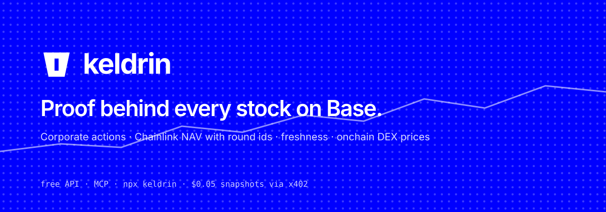

<p align="center">
  
</p>

<p align="center">
  <a href="https://keldrin.vercel.app">keldrin.vercel.app</a> ·
  <a href="https://keldrin.vercel.app/explorer">Explorer</a> ·
  <a href="https://keldrin.vercel.app/playground">Playground</a> ·
  <a href="https://keldrin.vercel.app/transparency">Transparency</a> ·
  <a href="https://keldrin.vercel.app/start.md">5-minute start</a> ·
  <a href="https://keldrin.vercel.app/skill.md">Agent guide</a>
</p>

<p align="center">
  keldrin is the verified record for Coinbase tokenized stocks on Base: what happened (dividends, splits, multiplier
  changes), what a token is worth (Chainlink NAV, with the round id behind every point), how fresh that is, and where it
  trades onchain. Every value names its source, and you can re-check it yourself.<br/>
  <strong>Free API, MCP and CLI. One-call snapshots and reports at $0.05 USDC on Base via x402, charged only on a complete answer.</strong>
</p>

> **🤖 Using an AI agent?** Point it here: **read https://keldrin.vercel.app/skill.md and follow it.**

<div align="center">

[](https://github.com/danbuildss/Keldrin/actions/workflows/starter-ci.yml)
[](https://www.npmjs.com/package/keldrin)
[](#how-payment-works)
[](#quick-start)

</div>

## Vision

Tokenized stocks are programmable, but the facts around them are scattered: corporate actions in SEC filings, multipliers
onchain, NAV in Chainlink rounds, prices across DEX pools. Every app and agent rebuilds the same plumbing and guesses at
the gaps. keldrin researches once, verifies independently, and serves the record to everyone, with "unknown" as a valid
answer and never a guess. It is a record, not a trading signal, adviser or price oracle.

## How it works

```
 SEC filings ──┐
 Coinbase B20  ├─▶ research (GitHub Actions, every 8 h) ─▶ independent verification ─▶ Supabase ─▶ API · MCP · CLI · x402
 Chainlink NAV │     deterministic, append-only               second provider, fail closed        read-only, live reads
 DEX pools ────┘
```

- **Corporate actions** are matched to the issuer's SEC filing and the onchain multiplier event, then re-verified.
- **Chainlink NAV** rounds are re-read with `getRoundData` through a second RPC provider; only rounds the proxy officially served count.
- **DEX pools** are re-derived from canonical factories; prices are read at one block, with depth capped by what each pool holds.
- **Freshness** is judged in NYSE trading time against each feed's own update rhythm.

## Quick start

```bash
# free, no key
curl "https://keldrin.vercel.app/v1/assets/0xb20000000000000000000078ee7ce2fE4908108C/market-context"
curl "https://keldrin.vercel.app/v1/assets/0xb20000000000000000000078ee7ce2fE4908108C/nav/history?interval=daily&from=2026-11-01"
curl "https://keldrin.vercel.app/v1/overview"
```

```bash
# AI agents (remote MCP, 8 tools)
claude mcp add --transport http keldrin https://keldrin.vercel.app/mcp
```

```bash
# CLI, zero dependencies; verify-* re-checks served values against Base yourself
npx -y keldrin context NVDAc
npx -y keldrin verify-nav NVDAc
```

```bash
# one-call answers: 3 free a day, then x402
curl "https://keldrin.vercel.app/v1/snapshot"
curl -i "https://keldrin.vercel.app/api/snapshot"   # → 402 with the x402 terms in the payment-required header
```

## A real example

`GET /v1/assets/{NVDAc}/market-context` on production, 2026-11-28 (trimmed):

```json
{
  "symbol": "NVDAc",
  "market": { "session": "closed" },
  "nav": { "nav": "149.61143864", "round_id": "36893488147419105210", "updated_at": "2026-11-27T18:35:16.000Z", "age_s": 23326 },
  "staleness": { "state": "expected_closed" },
  "dex": { "price_usd": "148.71075720", "venue": "uniswap_v3", "block": "63187341", "depth_2pct_usd": 9860.72, "nav_premium_pct": -0.602 }
}
```

The round id re-reads onchain on feed `0x04689a41629776563E6822F76f2e57D148d28513`; the DEX price is pinned to block
63,187,341. Explore it on the [stock page](https://keldrin.vercel.app/explorer?token=NVDAc).

## What the fields mean

| Field | Meaning |
|---|---|
| `nav` | Chainlink's last published total-return NAV (dividends and splits included). A reference, not a live equity price. |
| `staleness.state` | `fresh`, `expected_closed` (market closed, correctly held), `unexpectedly_stale` (don't rely on it), `unknown` |
| `dex.nav_premium_pct` | Main DEX price vs NAV; withheld (`null` + reason) when the NAV is stale or unknown |
| corporate action `status` | `verified_matched`, `confirmed_onchain`, `predicted` (announced, not applied), `late` |
| `multiplier_*_wad` | Shares per token × 1e18. Balances never change; the multiplier does. |

Full guide: [skill.md](https://keldrin.vercel.app/skill.md) · contract: [openapi.json](https://keldrin.vercel.app/openapi.json).

## How payment works

`/api/snapshot` and `/api/report?token=` (hosted on Bankr x402 Cloud) cost **$0.05 USDC on Base**: x402 v2, scheme
`exact`, network `eip155:8453`, amount `50000`, payTo Bankr's fee router `0x8AEE621035D93Deb3C0C1177fac252dC2dd501a0`.
Only a complete answer (2xx) is charged; anything incomplete is a free 503. Sign once and never re-sign automatically.
A first real payment settled on 2026-11-28 ([tx](https://basescan.org/tx/0x5c3665fc952fb619bd869e4641ad391e30e2396281ea7a458596006bd7caab05)).

## Coverage, limits and privacy

- 435 tokens tracked (identity, multiplier, corporate actions); 13 with Chainlink NAV, market context and DEX prices.
- NAV history starts at each feed's first official round (August 2026; ANTc November 2026).
- Free and keyless, 300 requests per minute per IP. Live values come from public RPC at request time; a failed read is
  `null` with a reason.
- No request content is stored. The free-try counter keeps a salted hash of the client address for 2 days.
- Facts with provenance, not investment advice. Not affiliated with Base, Coinbase or Chainlink.

Live numbers, payments counted onchain and methodology: [Transparency](https://keldrin.vercel.app/transparency).

## Docs

| | |
|---|---|
| [5-minute start](https://keldrin.vercel.app/start.md) | feeds, coverage, cURL |
| [Agent guide](https://keldrin.vercel.app/skill.md) | when to use keldrin, how to read answers, how to pay |
| [llms.txt](https://keldrin.vercel.app/llms.txt) · [OpenAPI](https://keldrin.vercel.app/openapi.json) | every route |
| [docs/LAUNCH_REPORT.md](docs/LAUNCH_REPORT.md) | what is built, verified and open |
| [BACKEND_PROOF.md](BACKEND_PROOF.md) | evidence for each phase |

## Development

```bash
npm ci
npm test                      # offline; set KELDRIN_TEST_PG_ADMIN for the real-Postgres role tests
npm run build:api             # the deployed Vercel function is the committed bundle (CI checks it)
node scripts/status-check.mjs # live checks, including the x402 terms
node scripts/external-tests.mjs
```

Governance for contributors and agents working in this repository: [CLAUDE.md](CLAUDE.md), [DECISIONS.md](DECISIONS.md),
[STATUS.md](STATUS.md). Earlier workspace notes: [docs/WORKSPACE.md](docs/WORKSPACE.md).

## License

Private repository for now; an open-source release of the code is planned (TASKS T044). keldrin, built by SOMEHOW.
